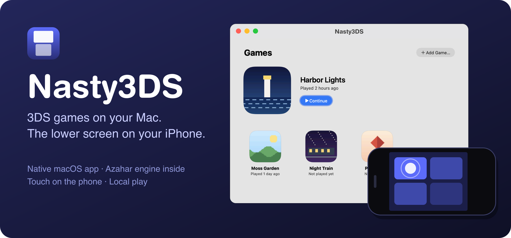
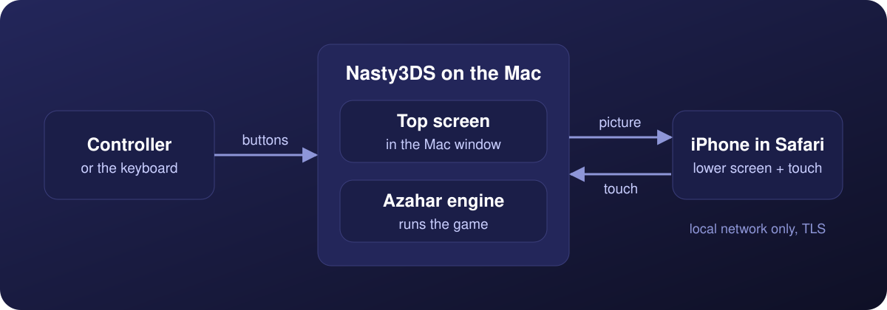
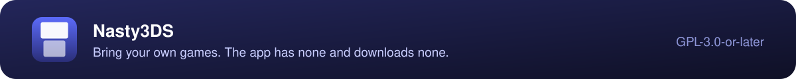

<p align="center">
  
</p>

<p align="center">
  <a href="https://github.com/esoteric-frog/nasty3ds/actions/workflows/ci.yml"></a>
  
  
  <a href="LICENSE"></a>
</p>

**Nasty3DS is a native Mac app that plays your own 3DS games: the top screen on the Mac, the lower screen with touch on your iPhone.** The engine is [Azahar](https://github.com/azahar-emu/azahar). The app around it is new and made for macOS.

Status: early (version 0.3). It runs games at full speed on an M1 MacBook Air. See [Limits](#limits).

> [!IMPORTANT]
> Bring your own games. The app has no games, does not download games, and does not decrypt games. Use files that you made from cartridges that you own.

## What you get

- **Your games on the start screen.** Each game shows its own icon and name. Press Return to continue the game you played last.
- **The lower screen on your iPhone.** Scan one QR code. The picture goes to Safari on the phone, and your taps go back to the game. No iPhone app to install.
- **A controller, with no setup.** A controller that macOS knows works at once (tested with an Xbox controller). The keyboard works too.
- **Local play between two Macs.** One player hosts a room, the other joins it from a menu. The game's own local wireless (trade, battle) then works over your network.
- **A copy of your save before each start.** The app keeps the newest 10 copies for each game.

## How it works

<p align="center">
  
</p>

The app loads Azahar's libretro core as a library, draws with Vulkan through MoltenVK, and paces frames from the sound buffer. The phone page is one self-contained web page, served over HTTPS by the app, with a certificate that only your Mac's `.local` name can use.

## Build it

You need an Apple Silicon Mac, macOS 14 or later, the Xcode Command Line Tools, and [Homebrew](https://brew.sh).

```sh
brew install cmake ninja molten-vk
git clone https://github.com/esoteric-frog/nasty3ds.git
cd nasty3ds
scripts/build-core.sh     # gets Azahar at a pinned commit, applies patches/, builds the engine (about 40 minutes)
scripts/make-app.sh       # makes dist/Nasty3DS.app
open dist/Nasty3DS.app
```

Then click **Add Game** and select a game file (`.3ds`, `.cci`, `.cxi`). The app moves the file into its library folder.

To run from the source folder: `scripts/play.sh`.

## Use the iPhone as the lower screen

1. Start a game. Select **Game > Use Phone for Lower Screen**.
2. One time only: the sheet sends a small certificate to the iPhone by AirDrop and shows the steps to trust it.
3. Point the iPhone camera at the QR code.

The Mac and the iPhone must be on the same network. With no Wi-Fi, the iPhone's Personal Hotspot works.

## Play with a second Mac

1. Both players start a game.
2. Player one: **Game > Local Play > Host a Room**.
3. Player two: **Game > Local Play > Join**.
4. Use the local wireless function inside the game.

> [!WARNING]
> A room has no password. While it is open, each device on your local network can try to join it. Host a room only on a network that you trust, and close it when you finish.

## Tests

```sh
scripts/test.sh          # unit tests (Swift Testing)
scripts/check-host.sh    # the real host code against a small stand-in engine
scripts/check-phone.sh   # the real phone server over TLS
scripts/check-page.sh    # the real phone page in WebKit
scripts/check-room.sh    # hostile packets against a real hosted room (needs a game file)
```

## Limits

- Apple Silicon only. No Intel build.
- The app is not signed with an Apple developer account. A built copy on another Mac needs **Open Anyway** in System Settings one time.
- Local play is tested with two copies of the app on one Mac. A full trade between two Macs is not yet confirmed.
- No controller setup screen yet: the button map is fixed.
- Compressed game files (`.zcci`, `.cia`, `.3dsx`) start, but show no icon and get no save copy.

## The engine and its license

Nasty3DS is licensed under [GPL-3.0-or-later](LICENSE), the same license as Azahar.

- The engine is built from Azahar's source at a pinned commit. `patches/` holds the changes that Nasty3DS makes to it: a small C interface for local play rooms, and input checks in the room and local wireless code.
- These patches were written with help from an AI model. Azahar's [AI policy](https://github.com/azahar-emu/azahar/blob/master/AI-POLICY.md) does not accept such code, so **do not send these patches to the Azahar project.**
- `Sources/CN3Host/libretro.h` and `libretro_vulkan.h` come from the libretro project and keep their MIT license.
- Nasty3DS is not affiliated with Nintendo or with the Azahar project. "Nintendo 3DS" is a trademark of Nintendo.

See [CONTRIBUTING.md](CONTRIBUTING.md) to help, and [SECURITY.md](SECURITY.md) to report a security problem.

<p align="center">
  
</p>
